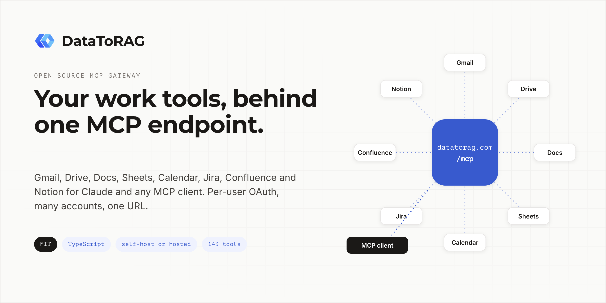
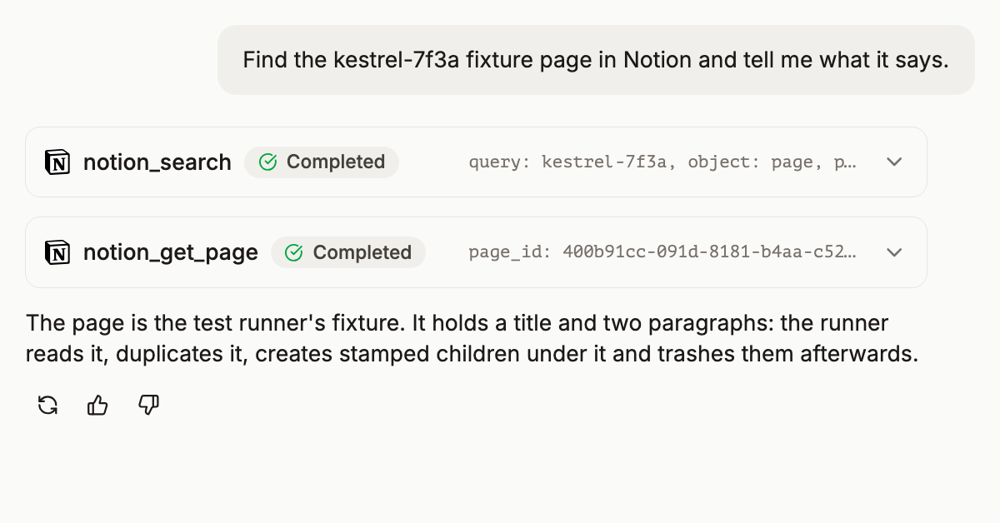
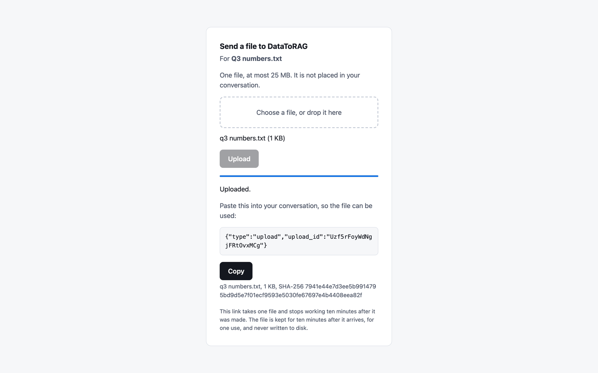
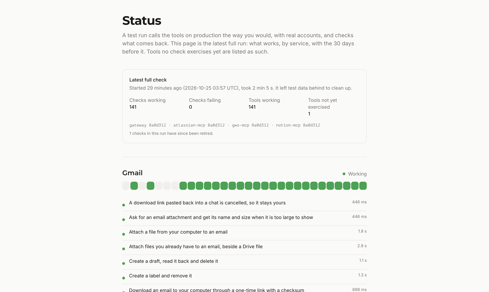
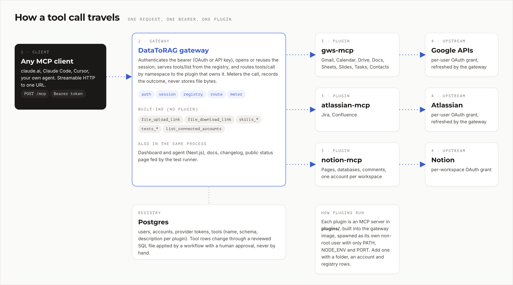

<p align="center">
  
</p>

<p align="center">
  Google Workspace, Jira, Confluence and Notion for Claude and other MCP clients, through one endpoint.
</p>

<p align="center">
  <a href="LICENSE"></a>
  <a href="https://github.com/datatorag/mcp-gateway/actions/workflows/ci.yml"></a>
  <a href="https://github.com/datatorag/mcp-gateway/commits/main"></a>
  <a href="#connectors"></a>
  <a href="https://datatorag.com/docs/getting-started"></a>
</p>

DataToRAG is an open-source [Model Context Protocol](https://modelcontextprotocol.io) gateway. You point your AI client at one URL. Each person connects their own Google, Atlassian and Notion accounts, and the gateway hands the client the tools for those accounts, calling the services with the person's own OAuth grant. It runs hosted at [datatorag.com](https://datatorag.com), or on your own infrastructure under the MIT license.

[Website](https://datatorag.com) · [Docs](https://datatorag.com/docs/getting-started) · [Status](https://datatorag.com/status) · [Changelog](https://datatorag.com/changelog) · [Skills](https://datatorag.com/skills)

## Try it in 60 seconds

Setup is two connections, and both are needed:

1. **Connect your accounts.** Sign in at [datatorag.com/dashboard](https://datatorag.com/dashboard) and connect Google, Atlassian or Notion. Google's consent screen arrives with every box unticked: tick "Select all", or the services you want.
2. **Connect your AI client** to `https://datatorag.com/mcp`, then sign in with the same email when the client asks.

**Claude (web and Desktop).** Customize, then Connectors, then Add, then "Add custom connector". Paste the URL and leave the advanced OAuth fields empty.

**Claude Code.**

```bash
claude mcp add --transport http datatorag https://datatorag.com/mcp
```

**Cursor and other clients that take a JSON config.**

```json
{
  "mcpServers": {
    "datatorag": {
      "url": "https://datatorag.com/mcp"
    }
  }
}
```

**ChatGPT.** Settings, then Connectors, enable Developer mode, then Create, and paste the URL.

The [getting started guide](https://datatorag.com/docs/getting-started) has screenshots of each step. Every client connects with OAuth.

The server is listed in the [official MCP registry](https://registry.modelcontextprotocol.io) as `com.datatorag/mcp-gateway`; [`server.json`](server.json) is the listing.

## Screenshots

<p align="center">
  
</p>
<p align="center"><sub>The agent in the dashboard runs the same tools against your connected accounts, with no client setup.</sub></p>

<p align="center">
  
</p>
<p align="center"><sub>An upload link takes one file from your computer, up to 25 MB, and answers its size and SHA-256.</sub></p>

<p align="center">
  
</p>
<p align="center"><sub>The status page shows the latest end-to-end run against production, by service.</sub></p>

## Connectors

Tool counts are from the code as of October 2026: 133 tools in the three connectors, and 10 built into the gateway.

| Connector | Tools | Services | Docs |
|---|---|---|---|
| Google Workspace (`plugins/gws-mcp`) | 87 | Gmail, Calendar, Drive, Docs, Sheets, Slides, Contacts, Tasks | [docs](https://datatorag.com/docs/google-workspace) |
| Atlassian (`plugins/atlassian-mcp`) | 28 | Jira, Confluence | [docs](https://datatorag.com/docs/atlassian) |
| Notion (`plugins/notion-mcp`) | 18 | Pages, databases, comments | [docs](https://datatorag.com/docs/notion) |
| Gateway built-ins | 10 | Connected accounts, skills, file upload and download links, a connectivity check | [docs](https://datatorag.com/docs/file-references) |

The three connectors live in this repository under `plugins/` and ship inside the gateway's image. A client only sees the tools for services its user has connected.

## What makes it different

**Several accounts per service.** Connect a work and a personal Google account, or two Notion workspaces, under one login, and pick a default. Every connector tool takes an `account` argument to choose one ([how we built it](https://datatorag.com/blog/how-we-built-multi-account-for-mcp)).

**Responses sized for a context window.** Tools return what the model needs rather than the raw API response. A two-page Google Doc comes back as 2 to 3 KB of text instead of 50 KB or more of JSON ([the write-up](https://datatorag.com/blog/why-your-mcp-server-is-eating-your-context-window)).

**OAuth per user.** Each person grants access to their own accounts, and the gateway refreshes the grants. A connector receives only the calling user's access token, never a shared credential.

**Files move between services without passing through the chat.** A file reference names an email, an attachment or a Drive file, and the gateway carries it to Jira, Drive or an email in one call, answering with its size and SHA-256. Files from your computer arrive through a single-use upload link ([file references](https://datatorag.com/docs/file-references)).

**Skills.** Ready-made workflows, such as a morning brief or inbox triage, that run in the dashboard, on a schedule, or from any client as MCP prompts ([skills](https://datatorag.com/skills), [announcement](https://datatorag.com/blog/skills-are-live)).

**A public status page.** A test run calls the tools on production the way a user would and publishes what works, by service ([status](https://datatorag.com/status)).

## Architecture

<p align="center">
  
</p>

In text:

1. **Client.** Any MCP client sends Streamable HTTP to `POST /mcp` with a bearer token: an OAuth access token from the gateway's own authorization server, the only credential it accepts.
2. **Gateway** (`apps/gateway`, one Node.js process: Express plus Next.js). It authenticates the bearer, opens or reuses the session, and answers `tools/list` from the `tools` table in Postgres, filtered to the services the user has connected. A `tools/call` is split on `__` into the plugin and the tool, the user's token for that service is resolved (and refreshed if expired), and the call is forwarded to the plugin. Every call is metered. The same process serves the dashboard and its agent, the docs, the changelog and the status page.
3. **Built-ins.** `list_connected_accounts`, `skills_*`, `file_upload_link` and `file_download_link` are answered by the gateway itself, with no plugin and no registry row.
4. **Plugins.** Each connector is an MCP server under `plugins/`. The gateway starts each one as a child process under its own non-root account, with an environment of `PATH`, `NODE_ENV` and `PORT` only, and passes the user's token on each call in the `X-User-Token` header. A crashing plugin is restarted up to three times a minute, and `/health` reports each plugin as up or down.
5. **Registry.** Postgres holds users, connected accounts, provider tokens and the tool registry (name, description and input schema for each plugin tool). Changes to the registry in production are SQL files under `registry/`, applied by the `registry` workflow after an approval.

## Self-hosting

### Prerequisites

- Node.js 20 or later and pnpm 9.
- A Postgres database, and its connection string as `DATABASE_URL`. Any Postgres works; nothing here starts one for you.
- An OAuth client for each provider you want: Google (one client for sign-in, a second for Workspace scopes), Atlassian, Notion.

### Run the gateway

```bash
pnpm install
pnpm -r --filter "./packages/*" run build    # the gateway reads these packages' built output

cp .env.example .env                          # then fill in DATABASE_URL, CONNECTION_TOKEN_KEYS and the OAuth clients
pnpm --filter @datatorag-mcp/db db:migrate    # schema changes are never applied on start

pnpm dev:gateway
```

The gateway listens on `http://localhost:8285` (set by `GATEWAY_PORT`):

| Path | What it is |
|---|---|
| `/mcp` | The MCP endpoint |
| `/dashboard` | Sign in, connect accounts, the agent |
| `/docs/getting-started` | The docs |
| `/health` | Liveness, and each plugin's state |
| `/.well-known/oauth-authorization-server` | OAuth metadata for MCP clients |

On a laptop the gateway loads plugins from `~/.datatorag/plugins`, or from `DATATORAG_PLUGINS_DIR` when it is set. Build them with `pnpm --filter @datatorag-mcp/gws-mcp run build` (and the same for `atlassian-mcp` and `notion-mcp`).

### Environment variables

The full list, with comments, is in [`.env.example`](.env.example), and the schema that validates it is [`packages/config/src/index.ts`](packages/config/src/index.ts). The ones a self-host needs:

| Variable | Purpose |
|---|---|
| `DATABASE_URL` | Postgres connection string. Required |
| `CONNECTION_TOKEN_KEYS` | Keys the provider tokens are encrypted with: `<id>:<base64 of 32 bytes>`, comma separated, the first encrypts and all decrypt. Required; make one with `openssl rand -base64 32` |
| `GATEWAY_PORT`, `GATEWAY_BASE_URL` | Port, and the public URL OAuth redirects are built from |
| `GOOGLE_CLIENT_ID`, `GOOGLE_CLIENT_SECRET` | Google sign-in for the dashboard |
| `GOOGLE_GWS_CLIENT_ID`, `GOOGLE_GWS_CLIENT_SECRET` | Google Workspace connections |
| `ATLASSIAN_CLIENT_ID`, `ATLASSIAN_CLIENT_SECRET` | Jira and Confluence connections |
| `NOTION_OAUTH_CLIENT_ID`, `NOTION_OAUTH_CLIENT_SECRET` | Notion connections |
| `ANTHROPIC_API_KEY`, `PLAYGROUND_MODEL` | The dashboard agent; empty turns it off |
| `STRIPE_*` | Billing; optional |
| `POSTHOG_API_KEY`, `SLACK_BOT_TOKEN`, `BREVO_API_KEY` | Analytics, notifications and email; each is off when empty |

### Production

Production runs the image built from `apps/gateway/Dockerfile`, which carries the three plugins. A merge to `main` builds and publishes it ([`build.yml`](.github/workflows/build.yml)), and a deploy is dispatched by hand and approved ([`release.yml`](.github/workflows/release.yml)), starting it with [`docker/docker-compose.prod.yml`](docker/docker-compose.prod.yml).

## Project structure

```
apps/gateway/          The product: MCP gateway, OAuth server, dashboard, site
  server.ts            Express entry: /mcp, /oauth, /auth, /files, /health
  src/gateway/         Tool routing, auth, plugin manager, file references, metering
  src/app/             Next.js app: dashboard, docs, blog, changelog, status, skills
  src/mastra/          The dashboard agent
  content/             Markdown for the blog, changelog, docs and skills
packages/
  config/              Environment schema (zod)
  db/                  Drizzle schema and migrations
  auth/                Token hashing and constant-time compares
  types/               Shared types, including the plugin manifest
plugins/
  gws-mcp/             Google Workspace connector
  atlassian-mcp/       Jira and Confluence connector
  notion-mcp/          Notion connector
registry/              Reviewed SQL for changes to the tool registry
docker/                Compose files
scripts/               The pre-merge gate, leak scan, deploy and registry helpers
docs/                  Architecture notes and implementation plans
tools/capture/         Product screenshots and recordings (Remotion)
```

## Contributing

Issues and pull requests are welcome. For a substantial change, open an issue first so we can agree on the direction; every pull request runs the gate (typecheck and tests) and a leak scan.

## Security

Please report a vulnerability privately to support@datatorag.com rather than in a public issue.

## License

[MIT](LICENSE)
